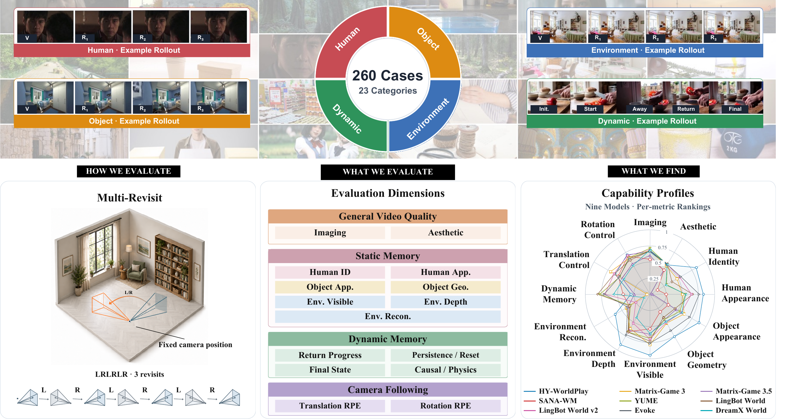

<div align="center">
  <h1>WorldMemBench: A Comprehensive Benchmark for<br>Memory of Video World Models</h1>
</div>

<div align="center">
  <p>
    <strong>Nan Zhou</strong><sup>1,3,&ast;</sup>, <strong>Jianxiong Gao</strong><sup>2,3,&ast;</sup>, Qiuyu Wang<sup>3</sup>, Wen Wang<sup>1</sup>, Jiahao Wang<sup>4,3</sup>,<br>
    Yufeng Yuan<sup>4,3</sup>, Shuaiting Li<sup>1,3</sup>, Hao Ouyang<sup>3</sup>, Yujun Shen<sup>3</sup>, Weiming Lu<sup>1</sup>,<br>
    Jun Xiao<sup>1</sup>, Yueting Zhuang<sup>1</sup>, YongLiang Shen<sup>1,&dagger;</sup><br>
    <sup>1</sup> Zhejiang University &nbsp;&nbsp; <sup>2</sup> Fudan University &nbsp;&nbsp; <sup>3</sup> Ant Group &nbsp;&nbsp; <sup>4</sup> Nanjing University<br>
  </p>
</div>

<div align="center">
  <p>
    <a href="https://arxiv.org/abs/2610.19063"></a>
    <a href="https://huggingface.co/papers/2610.19063"></a>
    <a href="https://huggingface.co/datasets/rescuerz/WorldMemBench"></a>
    <a href="https://zju-real.github.io/WorldMemBench/"></a>
    <a href="https://zju-real.github.io/WorldMemBench/#leaderboard"></a>
  </p>
</div>

<div align="center">
  <a href="assets/teaser.pdf"></a>
</div>

## News

- [2026/10/13] Our [paper](https://arxiv.org/abs/2610.19063) is available on arXiv.
- [2026/10/09] Our [evaluation code](#quick-start) is released.
- [2026/10/09] Our [inference results](https://huggingface.co/datasets/rescuerz/WorldMemBench) are available on Hugging Face.

## Table of Contents <!-- omit in toc -->

- [Installation](#installation)
- [Quick Start](#quick-start)
- [Metrics](#metrics)
- [Leaderboard Submission](#leaderboard-submission)
- [Acknowledgement](#acknowledgement)
- [Citation](#citation)
- [License](#license)

## Installation

### Scoring environment

```bash
git clone --recurse-submodules https://github.com/ZJU-REAL/WorldMemBench.git
cd WorldMemBench

# For an existing checkout cloned without submodules
# git submodule update --init --recursive

conda create -n worldmembench python=3.10 pip -y
conda activate worldmembench

python -m pip install "setuptools==80.10.2" "numpy==1.26.4"
python -m pip install torch==2.9.0 torchvision==0.24.0 \
    --index-url https://download.pytorch.org/whl/cu126
python -m pip install -e '.[general-video-quality,human,object,environment,dynamic,camera]'
python -m pip check
python -c "import torch, transformers; print('PyTorch:', torch.__version__); print('Transformers:', transformers.__version__); print('CUDA available:', torch.cuda.is_available())"
worldmembench list-metrics

# Download examples and evaluation weights
hf download rescuerz/WorldMemBench-examples --repo-type dataset --local-dir ./examples
hf download rescuerz/WorldMemBench-weights --local-dir ./weights
# Optional: full inference results
# hf download rescuerz/WorldMemBench --repo-type dataset --local-dir ./data

# Verify local weights and create the metric links (no downloads)
python scripts/download_weights.py --verify
```

### Additional environments

DA3 prepares depth and camera poses; ViPE is additionally required for Camera Translation; vLLM serves the Dynamic Memory judge.

```bash
# DA3
conda create -n worldmembench-da3 python=3.10 pip -y
conda activate worldmembench-da3
python -m pip install "setuptools==80.10.2" "numpy==1.26.4"
python -m pip install torch==2.9.0 torchvision==0.24.0 xformers==0.0.33.post1 \
    --index-url https://download.pytorch.org/whl/cu126
python -m pip install -r scripts/requirements-da3.txt
python -m pip check
bash scripts/setup_da3_sources.sh

# ViPE: requires nvcc and a C++ compiler
conda create -n worldmembench-vipe python=3.10 pip -y
conda activate worldmembench-vipe
python -m pip install torch==2.9.0 torchvision==0.24.0 \
    --index-url https://download.pytorch.org/whl/cu126
python -m pip install -r scripts/requirements-vipe.txt
bash scripts/setup_vipe_sources.sh
python -m pip check

# vLLM: serves the Qwen3.8-27B weights downloaded above
conda create -n worldmembench-vllm python=3.10 pip -y
conda activate worldmembench-vllm
python -m pip install -r scripts/requirements-vllm.txt
python -m pip check
```

### Model weights

```text
weights/
├── models/
│   ├── buffalo_l/
│   ├── sam2-hiera-large/
│   ├── dinov2-large/
│   └── ...
└── metrics/
    ├── human_identity/
    │   ├── buffalo_l -> ../../models/buffalo_l
    │   └── ...
    ├── human_appearance/
    │   ├── buffalo_l -> ../../models/buffalo_l
    │   ├── sam2-hiera-large -> ../../models/sam2-hiera-large
    │   └── ...
    └── ...
```

| Metric directory under `weights/metrics/` | Linked models |
|---|---|
| `imaging_quality` | MUSIQ-SPAQ |
| `aesthetic_quality` | CLIP ViT-L/14, LAION aesthetic predictor |
| `human_identity` | buffalo_l, YOLO-World, CLIP ViT-B/32, SAM2 |
| `human_appearance` | Same Human models, plus DINOv2-Large |
| `object_appearance` | Grounding DINO Base, CLIP ViT-B/32, SAM2, DINOv2-Large |
| `object_geometry` | Grounding DINO Base, CLIP ViT-B/32, SAM2 |
| `environment_visible_memory` | DA3, SALAD, DINOv2-Large |
| `environment_depth_fidelity` | DA3, SALAD |
| `environment_scene_reconstruction` | DA3, SALAD, SegFormer |
| `dynamic_memory` | Qwen3.8-27B (loaded by the VLM server) |
| `camera_rotation` | DA3, SALAD (shared with Environment) |
| `camera_translation` | DA3, SALAD, ViPE pose-estimation models |

## Quick Start

Evaluate the downloaded examples from the project directory:

```bash
conda activate worldmembench
bash scripts/eval_demo.sh ./examples imaging_quality
```

To run all 12 metrics, first start the Dynamic Memory judge in a separate terminal. Adjust `--gpus` to your server:

```bash
conda activate worldmembench-vllm
python scripts/serve_Qwen3_8_27B_vllm.py --gpus 0,1,2,3,4,5,6,7
```

Then run all example manifests in the scoring terminal:

```bash
bash scripts/eval_demo.sh ./examples all
```

The runner uses the project's `weights/` directory by default. Results are saved under `examples/eval_results/<metric>/<run>/`. 

## Metrics

### Inputs

`worldmembench eval INPUT` accepts a video file, a directory of case videos, or a `manifest.jsonl` file. A directory is scanned recursively for supported video files.

The recommended directory layout is:

```text
/path/to/samples/
└── <model>/
    └── <category>/
        └── <trajectory>/
            └── case_000/
                ├── video.mp4
                └── <metric-specific files>
```

The input root may be outside this repository. Use this standard layout for direct directory evaluation. For another layout, provide a `manifest.jsonl`; JSONL contains one JSON object per video and supports explicit `video`, `item_id`, `model_id`, `category`, `condition_id`, `sample_id`, `annotations`, and `artifacts` fields. Paths are resolved relative to the manifest. See `examples/manifests/` for complete examples. 
| Metric | Required case inputs |
|---|---|
| Imaging/Aesthetic Quality | `video.mp4` only |
| Human Memory | `video.mp4`, `first_frame.jpg`, and `prompt.json` with source-image face boxes and target descriptions |
| Object Memory | `video.mp4`, `first_frame.jpg`, `object_mask.npy`, and `prompt.json` with the target description |
| Environment Memory | `video.mp4` and `trajectory.json`; missing DA3 artifacts can be generated automatically |
| Dynamic Memory | `video.mp4`, `trajectory.json`, `checklist.json`, and a running VLM service |
| Camera Rotation | `video.mp4`, `trajectory.json`, and per-frame `target_poses.npz`; missing DA3 poses can be generated automatically |
| Camera Translation | The Camera Rotation inputs; missing DA3 and ViPE poses can be generated automatically |


### Key options

| Option | What to choose |
|---|---|
| `--metrics` | Select the metrics to run; omit it to run all registered metrics. |
| `--models`, `--categories`, `--trajectories`, `--cases` | Filter models, categories, trajectories, or cases when the input contains more than you want to evaluate. |
| `--expected-revisits K` | For fixed Human/Object protocols, use `2` for LRLR/LRUD or `3` for LRLRLR. Omit it to detect returns automatically for directory inputs, or to preserve an annotated manifest's K. |
| `--gpus` / `--device` | Use `--gpus 0,1,2,3` for multiple GPUs or `--device cuda:0` for one; do not combine them. |
| `--output` | Choose a result directory. Default: `eval_results/<timestamp>/`. |
| `--vlm-backend`, `--vlm-base-url`, `--vlm-model`, `--vlm-api-key-env` | Configure the Dynamic Memory VLM. The default uses the local vLLM server shown in Quick Start. |

### General Video Quality

For General Video Quality, videos alone are sufficient:

```bash
worldmembench eval /path/to/samples \
    --metrics imaging_quality aesthetic_quality
```

To reproduce the paper's General Video Quality results, evaluate the 5,400 Human, Object, and Environment videos in the released dataset:

```bash
worldmembench eval ./data/general_video_quality/manifest.jsonl \
    --metrics imaging_quality aesthetic_quality
```

This manifest contains only these 5,400 videos; no category filter is needed.

### Human Memory

For direct directory evaluation, keep these three files together for each case:

```text
samples/<model>/human/<trajectory>/<case>/
├── video.mp4
├── first_frame.jpg
└── prompt.json
```

- `video.mp4` is the generated video.
- `first_frame.jpg` is the original source image used to identify the annotated target people; it is not the scoring reference.
- `prompt.json` contains `case_id`, source `frame_size` (`w`, `h`), and `annotations` with `target_face_bboxes_first_frame` and `target_descriptions`.

Evaluate both Human metrics on an external input directory:

```bash
worldmembench eval /path/to/samples/my-model/human \
    --metrics human_identity human_appearance
```

### Object Memory

For direct directory evaluation, keep these four files together for each case:

```text
samples/<model>/object/<trajectory>/<case>/
├── video.mp4
├── first_frame.jpg
├── object_mask.npy
└── prompt.json
```

- `video.mp4` is the generated video.
- `first_frame.jpg` is the original source image containing the target object.
- `object_mask.npy` is a non-empty, two-dimensional binary mask at the source-image resolution.
- `prompt.json` contains `case_id`, `first_frame`, source `frame_size`, and `object` with `target` and `object_mask`. The target description is used by the detector.

Evaluate both Object metrics on an external input directory:

```bash
worldmembench eval /path/to/samples/my-model/object \
    --metrics object_appearance object_geometry
```

### Environment Memory

For direct directory evaluation, keep the video and trajectory together. DA3 artifacts are generated automatically when missing and reused when present:

```text
samples/<model>/environment/<trajectory>/<case>/
├── video.mp4
├── trajectory.json
└── da3/
    ├── results.npz
    └── scene_geometry.npz
```

- `video.mp4` is the generated video.
- `trajectory.json` contains `actions`, `phase_transitions`, and `tail_hold_transitions`.
- `da3/results.npz` stores per-frame camera poses.
- `da3/scene_geometry.npz` stores sampled depth, confidence, intrinsics, and poses for Depth Fidelity and Scene Reconstruction.

Evaluate all three Environment metrics on an external input directory:

```bash
worldmembench eval /path/to/samples/my-model/environment \
    --metrics environment_visible_memory environment_depth_fidelity environment_scene_reconstruction
```

### Dynamic Memory

For direct directory evaluation, keep these three files together for each case:

```text
samples/<model>/dynamic_memory/<trajectory>/<case>/
├── video.mp4
├── trajectory.json
└── checklist.json
```

- `video.mp4` is the generated video.
- `trajectory.json` contains the LR-hold `actions`, `phase_transitions`, and `tail_hold_transitions`.
- `checklist.json` contains `case_id` and the questions with `id`, `category`, `question`, `expected_answer`, and `evidence_window`.

Choose either a locally hosted VLM or an external API. Both generate checklist answers, then compute scores against the expected answers.

#### Option 1: Local deployment

After installing the vLLM environment and downloading the weights, start Qwen3.8-27B in a separate terminal. Adjust `--gpus` to your available GPU memory:

```bash
conda activate worldmembench-vllm
python scripts/serve_Qwen3_8_27B_vllm.py --gpus 0,1,2,3,4,5,6,7
```

Then evaluate in the scoring environment:

```bash
conda activate worldmembench
worldmembench eval /path/to/samples/my-model/dynamic_memory \
    --metrics dynamic_memory
```

The evaluator defaults to `http://127.0.0.1:8001/v1` and model `Qwen3.8-27B`. Use `--vlm-base-url` if the server runs at another address or port.

#### Option 2: External API

Use an OpenAI-compatible Chat Completions endpoint with multi-image input support. 

```bash
conda activate worldmembench
export WORLDMEMBENCH_API_KEY="<your-api-key>"
worldmembench eval /path/to/samples/my-model/dynamic_memory \
    --metrics dynamic_memory \
    --vlm-backend api \
    --vlm-base-url https://your-provider.example/v1 \
    --vlm-model your-vision-model
```


### Camera Following

For direct directory evaluation, keep the target camera trajectory with each case. Predicted poses are generated automatically when missing and reused when present:

```text
samples/<model>/<category>/<trajectory>/<case>/
├── video.mp4
├── trajectory.json
├── target_poses.npz
├── da3/results.npz       # reused or generated automatically
└── vipe/results.npz      # needed for translation / mixed motion only
```

- `video.mp4` is the generated video.
- `trajectory.json` contains `camera_motion_type`: `rotation`, `translation`, or `mixed`.
- `target_poses.npz` contains the intended per-frame camera-to-world poses in `c2w`.
- `da3/results.npz` contains DA3 pose predictions.
- `vipe/results.npz` contains ViPE pose predictions required by translation and mixed motion.

Evaluate Camera Translation on an external input directory:

```bash
worldmembench eval /path/to/samples/my-model/camera_translation \
    --metrics camera_translation
```

Use `/path/to/samples/my-model/camera_rotation` with `--metrics camera_rotation` for pure rotation. Camera Rotation uses DA3; Camera Translation also uses ViPE.


## Leaderboard Submission

Coming soon.

## Acknowledgement

WorldMemBench builds on the following open-source projects. We thank their authors and contributors for making their code and models available:

- [VBench](https://github.com/Vchitect/VBench) — Video quality metrics
- [InsightFace](https://github.com/deepinsight/insightface) — Face detection and identity embeddings.
- [SAM2](https://github.com/facebookresearch/sam2) — Video segmentation and target tracking.
- [DINOv2](https://github.com/facebookresearch/dinov2) — Visual features for appearance and scene consistency.
- [Depth Anything 3](https://github.com/ByteDance-Seed/Depth-Anything-3) — Depth and camera pose estimation.
- [ViPE](https://github.com/nv-tlabs/vipe) — Video pose estimation.
- [SegFormer](https://huggingface.co/nvidia/segformer-b0-finetuned-ade-512-512) — Semantic segmentation for scene reconstruction evaluation.
- [Qwen](https://huggingface.co/Qwen/Qwen3.8-27B) and [vLLM](https://github.com/vllm-project/vllm) — Visual-language judging and model serving for Dynamic Memory.
- ... and many other excellent open-source projects

## Citation

If you find WorldMemBench useful for your research, please consider citing our paper.

```bibtex
@misc{zhou2026worldmembenchcomprehensivebenchmarkmemory,
  title={WorldMemBench: A Comprehensive Benchmark for Memory of Video World Models},
  author={Nan Zhou and Jianxiong Gao and Qiuyu Wang and Wen Wang and
          Jiahao Wang and Yufeng Yuan and Shuaiting Li and Hao Ouyang and
          Yujun Shen and Weiming Lu and Jun Xiao and Yueting Zhuang and
          Yongliang Shen},
  year={2026},
  eprint={2610.19063},
  archivePrefix={arXiv},
  primaryClass={cs.CV},
  url={https://arxiv.org/abs/2610.19063},
}
```

## License

Code: [MIT License](LICENSE). The separately distributed datasets and examples have their own terms. Third-party source submodules and model weights retain their original licenses.
